# gcalc

The very old graphic calculus project, resurrected ;-)

gcalc is a visual programming language made of **coloured cubes**. It starts
from a purely descriptive language — a cube is a coloured cube, or two cubes
assembled along one of the three axes of space — and turns it into a
programming language by adding the two constructs of the λ-calculus:
**abstraction** and **application**. Programs and the objects they compute
are the same thing: cubes, which are built, combined and evaluated by drag and
drop.

<p align="center">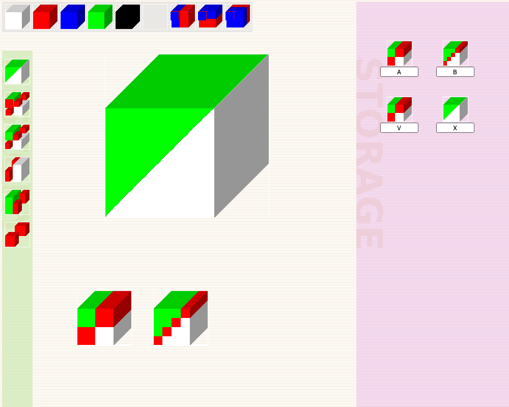</p>

*The diagonally divided cube `X = (V V)` of the 1994 paper, built in gcalc.
On the left, the history of every computed object; at the top, the
primitives; on the right, the storage with named objects.*

## The 1994 paper

The language is described in section 3 ("A Graphic Calculus") of:

> Yann Orlarey, Dominique Fober, Stéphane Letz, Mark Bilton.
> **Lambda Calculus and Music Calculi.**
> *Proceedings of the International Computer Music Conference (ICMC 1994)*,
> ICMA, pp. 243–250, 1994.
> [PDF](https://archive2010.grame.fr/ressources/publications/ICMC94LambdaCalc.pdf)

The paper shows that a purely descriptive language, without any programming
capability, becomes a programming language by adding abstraction and
application and by extending the reduction rules to the constructs of the
language. It applies the method twice: to this 3-D graphic calculus, then to
a music calculus (sequences and chords of notes, with infinite sequences,
loops and canons), and finally to a visual version of the music calculus.
The same ideas led to GRAME's Elody environment.

## The language

### Descriptive part

```
cube  ::= color
        | [cube1 | cube2]      left-right
        | [cube1 / cube2]      top-bottom
        | [cube1 ⁄ cube2]      front-back
color ::= white | red | blue | green | black | invisible
```

A construction of two cubes is still a cube: the two operands are contracted
along the construction axis. For instance, `A = [[green|red] / [red|white]]`:

| `A` | `B` = `A` where red is replaced by `A` | `X = (V V)` |
|:---:|:---:|:---:|
| 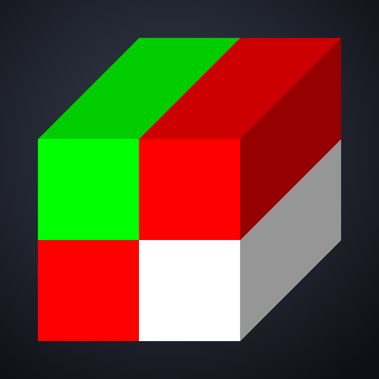 | 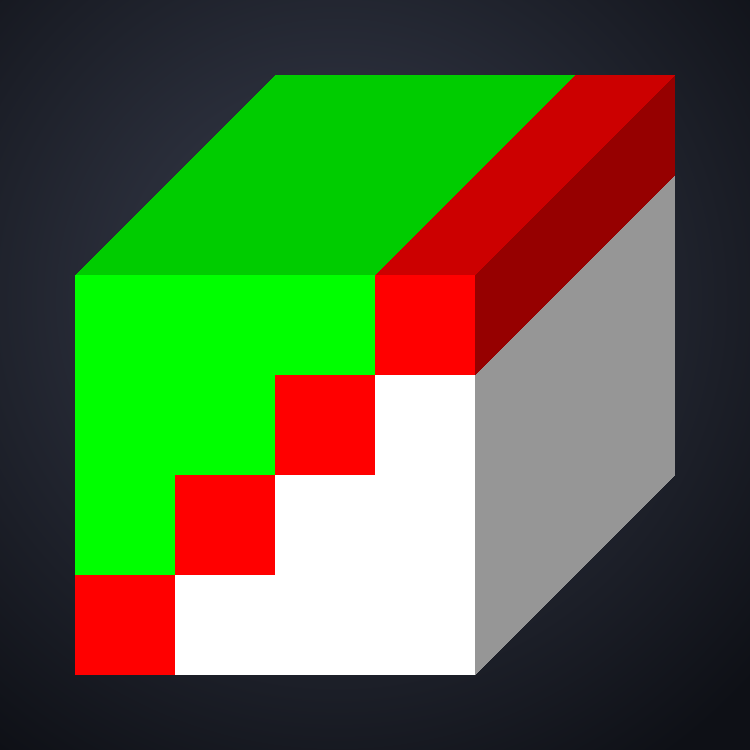 | 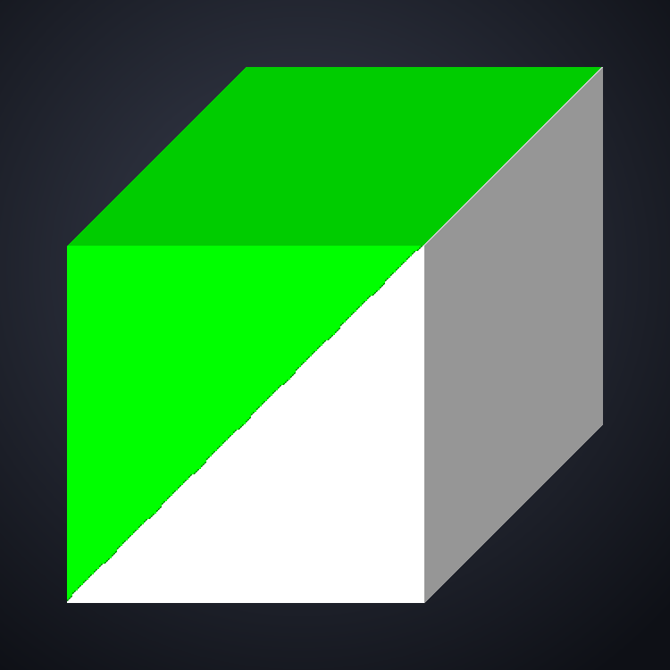 |

### Abstraction and application

```
cube ::= ...
       | λcolor.cube           abstraction: a colour becomes a variable
       | (cube1 cube2)         application
```

Colours play the role of variables: `λwhite.[white|blue]` is the function
"put a blue cube on the right of a cube". β-reduction replaces each
occurrence of the colour by the argument.

There is no recursion operator, but self-application is enough. The
diagonally divided cube above is the solution of `X = [[green|X] / [X|white]]`,
obtained as `X = (V V)` with

```
V = λred.[[green | (red red)] / [(red red) | white]]
```

Each application of `V` to itself unfolds one more level of the staircase;
the evaluation is lazy (normal order) and **stops by itself when a part
becomes too small to be displayed**, so infinite objects can be drawn. The
same construction with any two colours gives two full triangular prisms
separated by the diagonal plane:

```
D = λx.λa.λb.[[(x x a b) | b] / [a | (x x a b)]]      object = D D red blue
```

<p align="center">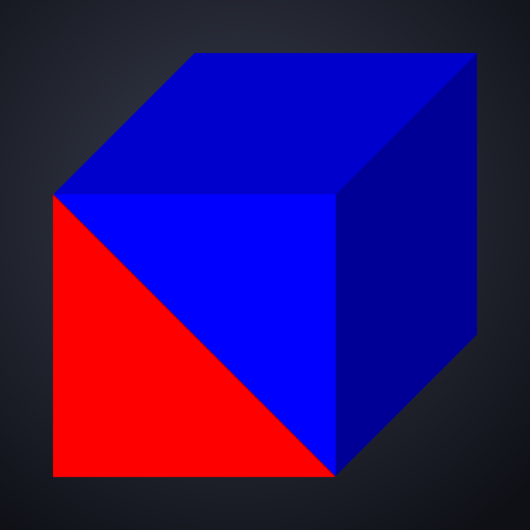</p>

### Functions in space

The reduction rules are extended to every construct: a construction applied
to a cube distributes the application along its axis, cutting the argument
into the corresponding halves:

```
([C1 | C2] X)  ⇒  [(C1 left(X)) | (C2 right(X))]
```

and the same for top/bottom and front/back. A function can therefore behave
differently in every region of space. With the booleans of the paper used
as selectors (`T = λblue.λgreen.blue`, `F = λblue.λgreen.green`,
`AND = λblue.λgreen.(blue green blue)`), three objects `A`, `B`, `C` made of
`T` and `F` on complementary axes are intersected, and
`X = λwhite.λinvisible.((AND A (AND B C)) white invisible)` gives the first
step of the sponge of section 3.2.3:

<p align="center">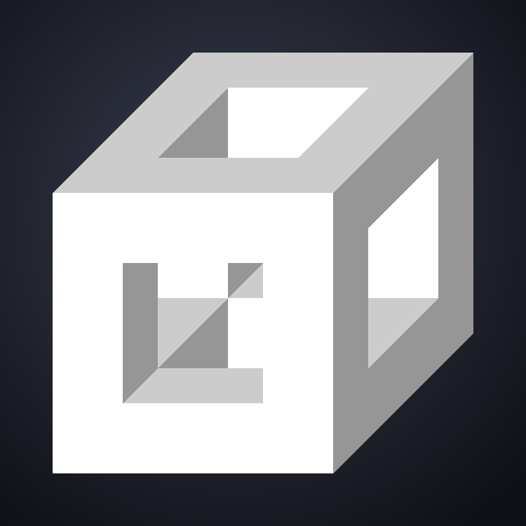</p>

Applying a colour to a cube ("`(white red) ⇒ pink`" in the paper) is not
implemented: such an application is left unevaluated.

### More examples

A function `T = λred.[[red|invisible] / [red|red]]` (a triangle of three
cubes, each one in the front half of its quarter) applied to its own result nests triangles; a three-argument version
gives each sub-triangle its own colour:

| `T red` | `T (T red)` | `Tc (T red) (T blue) (T green)` |
|:---:|:---:|:---:|
| 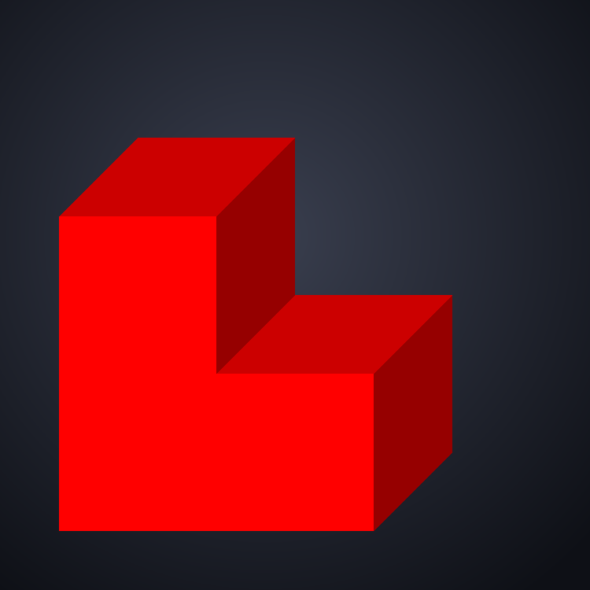 | 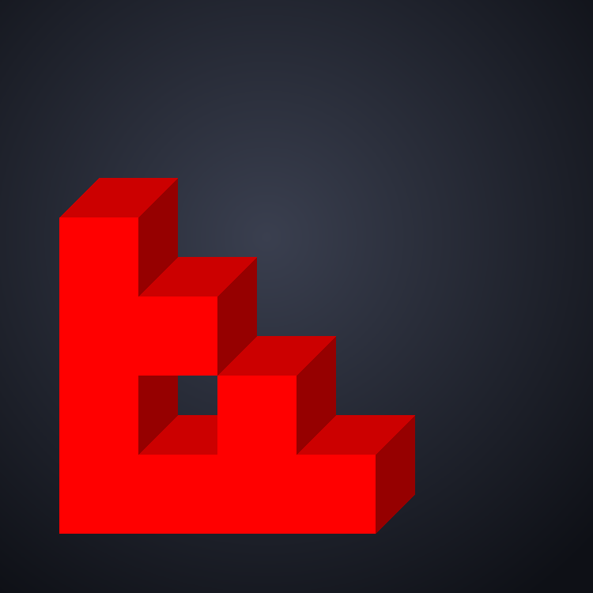 | 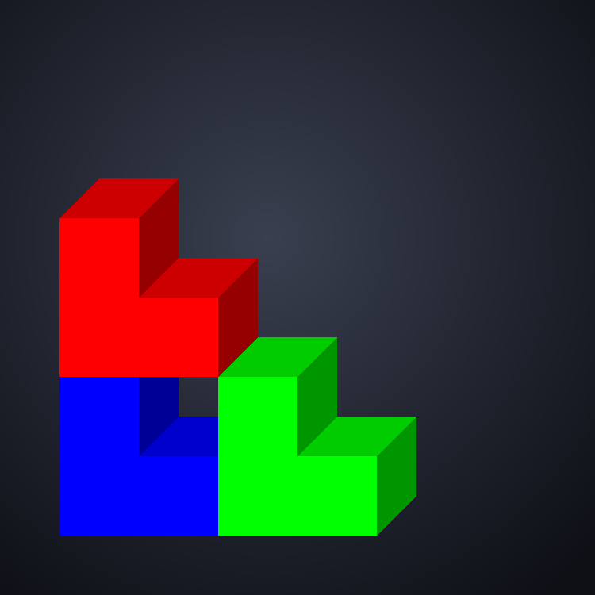 |

A 2×2×2 block where four octants call `x x b a` (the function applied to
itself, with the two colours swapped), one is solid and three are invisible
gives a Sierpinski-like fractal whose
colours alternate at each level:

<p align="center">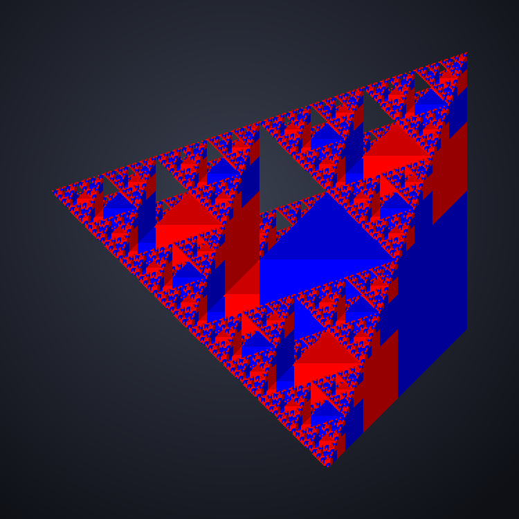</p>

## Using gcalc

<p align="center">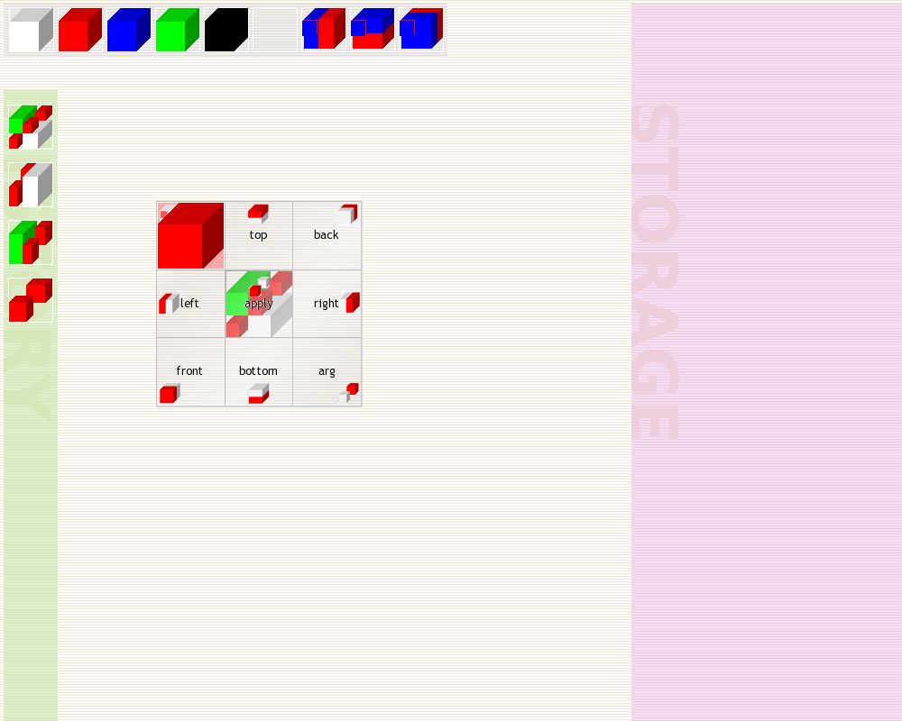</p>

*Abstracting red: a red cube dragged onto the body shows the operation
palette; the λ cell is highlighted.*

- **Primitives** (top bar): white, red, blue, green, black and invisible
  cubes, and the three construction functions (left-right, top-bottom,
  front-back) in curried form. Dragging one creates a copy in the workspace.
- **Operations**: drag a cube next to another one in the workspace and a
  3×3 palette appears around the target; drop on a cell to combine them:

  |  | left | centre | right |
  |---|---|---|---|
  | **top**    | λ (abstract the dragged colour) | put on top    | put behind |
  | **middle** | put on the left                 | apply dragged to target | put on the right |
  | **bottom** | put in front                    | put below     | apply target to dragged (arg) |

- **History** (left column): every computed object is pushed there and can
  be dragged back.
- **Storage** (right): drag objects there to keep them; the field under each
  one gives it a name.
- **Keys**: Ctrl-drag duplicates an object of the workspace, ↑ / ↓ zoom the
  selection, Backspace / Delete removes it, `X` exports it as a POV-Ray scene
  (`.pov`, rotating with `clock` for an animation).

## Building

gcalc needs Qt 6 (Widgets); it was last built with Qt 6.12 on macOS.

```bash
qmake gcalc2017.pro
make
```

### Rendering the images of this page

The `tools/` directory holds two small programs built on the same sources:

- `gcrender` builds a term with the language's own constructors (cubes,
  constructions, `abstract`, `application`), evaluates it and draws it with
  gcalc's `Represent()` into a PNG:
  `gcrender <object> <file.png> [size] [scale] [color1] [color2]`, with the
  colours in `RRGGBBAA` hexadecimal (`FF0000FF` is gcalc's red). The objects
  are listed in `makeObject()` in `tools/render.cpp`.
- `gcshot` drives the workspace through the palette operations, the same
  calls a drag and drop makes, to build `X = (V V)` step by step, and
  captures the window (`screenshot-*.png`).

```bash
mkdir -p build-tools && cd build-tools
qmake ../tools/gcrender.pro && make
QT_QPA_PLATFORM=offscreen ./gcrender paperX paper-X.png 300 2
```

## See also

- The Racket distribution includes another implementation,
  [GCalc — Visual λ-Calculus](https://docs.racket-lang.org/games/gcalc.html),
  which credits this work for its principles.
